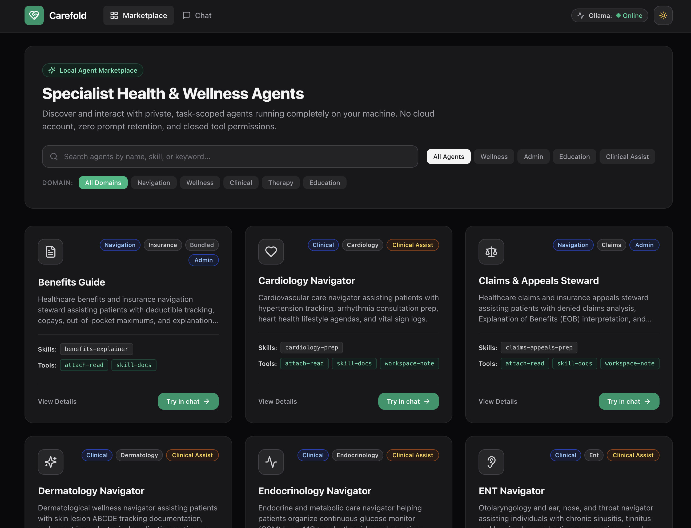

<!--
  Carefold — Healthcare AI Agent Marketplace & Runtime
  Copyright 2026 Spectrayan (https://spectrayan.com)

  Licensed under the PolyForm Noncommercial License 1.0.0 and the
  Carefold Additional Terms (see LICENSE and ADDITIONAL-TERMS.md).
  Personal and household local use only. Commercial use, hosted service
  offering, rebranding, white-labeling, and redistribution of modified
  forks are prohibited without a written commercial license from Spectrayan.

  Required Notice: Copyright 2026 Spectrayan (https://spectrayan.com)
-->

<h1 align="center">Carefold</h1>

<p align="center">
  <strong>Local-First Personal & Family Health AI Companion & Specialist Runtime.</strong>
</p>

<p align="center">
  <a href="LICENSE"></a>
  <a href="https://www.python.org/"></a>
  <a href="https://nodejs.org/"></a>
  <a href="https://nextjs.org/"></a>
  <a href="https://fastapi.tiangolo.com/"></a>
  <a href="docker/docker-compose.yml"></a>
  <a href="https://github.com/spectrayan/carefold/actions"></a>
  <a href="https://spectrayan.github.io/carefold/"></a>
</p>

<p align="center">
  <em>"Great care starts with prepared patients and supported families. Carefold brings local-first AI to your household—helping you organize records, prepare thoughtful questions for your care team, and navigate coverage with clarity and privacy."</em>
</p>

---

**Carefold** is a source-available, local-first personal and family health AI companion and specialist agent runtime. Designed to work alongside your doctors, care teams, and health plans, Carefold runs on your own hardware (or private household instance) to help you prepare for clinical visits, organize health records and vitals across family members, track preventive screenings and pediatric school forms, and understand health insurance benefits.

It pairs a **5-phase LangGraph orchestration engine** with **23 specialist clinical and administrative navigators**, **24 modular skill packs**, multi-profile household care with per-profile AES-256-GCM envelope encryption, scoped health and calendar connectors (`Epic SMART on FHIR`, `Withings`, `Google Calendar`, `CalDAV`, `Apple Health`, `FHIR R4`, `C-CDA`), multilingual support (`en-US`, `es-ES`, `fr-FR`, `hi-IN`, `ar-SA` with `RTL`), and a two-tier clinical safety guardrail system.

<details>
  <summary>📸 <strong>Preview Carefold Web Marketplace UI</strong> (Click to expand)</summary>
  <br />
  <p align="center">
    
  </p>
</details>

---

## ⚡ 30-Second Quickstart

Get a local Carefold runtime and household companion running in seconds:

### 1. Instant Launch via Prebuilt Docker Container
Run Carefold with a single command using the published multi-architecture image (supports Apple Silicon `arm64` and Intel/AMD `amd64` automatically):

```bash
# Pull and start the all-in-one container (Next.js UI on :3000, FastAPI backend on :8000)
docker pull ghcr.io/spectrayan/carefold:latest

# Run container (connecting to local Ollama on your host machine)
docker run -d \
  --name carefold \
  -p 3000:3000 \
  -p 8000:8000 \
  -e OLLAMA_URL=http://host.docker.internal:11434/v1 \
  -v carefold-data:/data \
  ghcr.io/spectrayan/carefold:latest
```
Visit `http://localhost:3000` to browse specialist helpers and launch private household consultations.

> [!TIP]
> - **Connecting to Ollama on host**: On Docker Desktop (macOS / Windows), use `-e OLLAMA_URL=http://host.docker.internal:11434/v1` so the container can reach your host machine's Ollama instance.
> - **Legacy tags on Apple Silicon**: If pulling older single-architecture tags (e.g. `0.3.0-beta.1`), append `--platform linux/amd64` to `docker pull` and `docker run`.

### 2. Launch via Docker Compose (Build from Source)
Images can also be built locally from [`docker/Dockerfile`](docker/Dockerfile):

```bash
# From the repository root: build and start the FastAPI backend (:8000) and Next.js UI (:3000)
docker compose -f docker/docker-compose.yml up -d --build

# Or also start a local Ollama container for on-device LLM inference:
docker compose -f docker/docker-compose.yml --profile ollama up -d --build

# Pull the default model into the Ollama container (first run only)
docker compose -f docker/docker-compose.yml exec ollama ollama pull llama3.2
```
Visit `http://localhost:3000` to browse specialist helpers and launch private consultations.

### 3. Local Monorepo Development

**Prerequisites**: Python 3.12+ (tested on 3.12 and 3.14), Node.js 22 LTS, and `pnpm` (>=9.0.0).

```bash
# Clone repository
git clone https://github.com/spectrayan/carefold.git
cd carefold

# Install frontend dependencies
pnpm install

# Set up backend environment
python3 -m venv backend/.venv
source backend/.venv/bin/activate
pip install -e backend
pip install -r backend/requirements-dev.txt

# Start backend server (Terminal 1)
uvicorn carefold.main:app --host 127.0.0.1 --port 8000 --reload

# Start Next.js UI (Terminal 2)
pnpm --filter web dev
```

---

## 🏥 Specialist Agent Topology

Carefold features a modular catalog of 23 specialist clinical and administrative navigators, organized into three core domains:

- **Clinical Organ & Specialty Navigators (`clinical_assist`)**: Dedicated navigators for Cardiology, Pulmonology, Gastroenterology, Oncology, Neurology, Nephrology, Dermatology, Endocrinology, Orthopedics, Rheumatology, Urology, ENT, Vision, Hematology, Podiatry, Vascular Medicine, Oral Health, and General Visit Preparation. Each specialist helps you organize symptoms, review lab trends and vital signs, and prepare clear, prioritized questions to discuss with your clinician.
- **Administrative & Insurance Stewards (`admin`)**: Stewards for Health Insurance Benefits & Coverage explanation, Prior Authorization preparation, Claims & Denials Appeals, Prescription Drug Formularies, and Multi-Provider Medical Records coordination.
- **Wellness & Habit Companions (`wellness`)**: Daily companions for chronic care routines, hydration tracking, sleep hygiene, and lifestyle check-ins.

### Exploring Available Agents

You can explore, search, and interact with all specialist agents through:
- **Web Consultation Studio**: Launch the web app (`pnpm dev:web` at `http://localhost:3000`) to browse and chat with any specialist helper.
- **Living Documentation Catalog**: Read [`docs/agents/catalog.md`](docs/agents/catalog.md) for detailed descriptions, taxonomy classifications, and key capabilities.
- **Carefold CLI & API**: Run `carefold list` or query `GET /api/agents` to inspect the runtime catalog programmatically.

### System Infrastructure Agents (`agents/_system`)
* **`orchestrator`**: Two-hop intent classification, dynamic skill provisioning, and multi-topology dispatch.
* **`document-extractor`**: Ingestion sandbox, PII sanitization, structured Pydantic extraction, and numerical grounding validation.
* **`quality-reviewer`**: Clinical safety boundary audit, tone inspection, and persona alignment verification.
* **`triage-auditor`**: Compliance logging, risk tagging, and clinical safety telemetry.
* **`skill-generator`**: Synthesis of dynamic skill manifests and validation templates from clinical guidelines.
* **`suggestion-generator`**: Context-aware follow-up suggestion chips presented in the client UI.

---

## 🧠 Cognitive Memory, Hybrid Retrieval & Household Isolation

Carefold implements a hexagonal architecture for memory, search, and household data isolation:

* **Per-Profile Household Scoping & Envelope Encryption**: Every family member profile (`Self`, `Child`, `Parent`, `Spouse`) is isolated at the database, Content-Addressed Storage (`CAS`), and cryptographic levels using per-profile `HKDF-SHA256` / `AES-256-GCM` Data Encryption Keys (`ADR-0005`, `ADR-0007`).
* **`MemoryPort` & 3-Tier Consolidation**: Cognitive memory interface supporting working, episodic, and semantic memory tiers with salience ranking and decay (`ADR-0002`).
* **Hybrid `SearchIndex`**: Combines SQLite `FTS5` lexical BM25 search with `sqlite-vec` dense embeddings, Reciprocal Rank Fusion (`RRF`), and Maximal Marginal Relevance (`MMR`).
* **End-to-End Internationalization (`ADR-0009`)**: Supports `en-US`, `es-ES`, `fr-FR`, `hi-IN`, and `ar-SA` (`RTL`) with IETF BCP 47 locale negotiation, Unicode UAX #15 `NFC` canonical storage normalization, HL7 FHIR R4 language-neutral clinical coding, and localized safety disclaimers.

---

## 🛡️ Two-Tier Clinical Safety, Policy Gates & Sandboxed Security

Carefold enforces strict safety invariants to protect families and ensure non-clinical boundaries:

### 1. Two-Tier Clinical Boundary System
* **Tier 1 (Multilingual Emergency Red Flags)**: Instant termination with `911`/`988`/`112` emergency escalation when acute symptoms are detected across supported languages (e.g., crushing chest pain, acute stroke FAST symptoms, anaphylaxis, severe respiratory distress, or active self-harm crisis).
* **Tier 2 (Collaborative Clinical Preparation)**: Helps patients organize questions and records for their licensed healthcare providers while never diagnosing conditions, prescribing medications, or adjusting dosages.

### 2. Four-Tier Policy Gate & Zero-Trust Sandbox (`ADR-0004`)
* **4-Tier Tool Execution Gate**: Classifies every tool into `read`, `write_local`, `write_external`, or `irreversible` across user-selectable autonomy levels (`A0` Manual, `A1` Assisted, `A2` Routine) with monotone taint tracking (`UntrustedResult`) and SHA-256 hash-chained `audit_events`.
* **Path Traversal & Symlink Shield**: Strict lexical normalization and containment checks preventing `../` traversal, null bytes, and symlink escapes across `attachments/` and `workspace/notes/`.
* **47-Attack Penetration Test Suite**: Automated security verification covering path traversal, command injection, symlink overwrites, and unauthorized skill access.

---

## 🚀 Quality Gates & Verification Matrix

Carefold maintains rigorous verification standards across all code changes:

```bash
# 1. Spectrayan License Header Check
pnpm run check:licenses

# 2. Backend Pytest Suite
PYTHONPATH=backend/src:libs/connectors backend/.venv/bin/pytest backend/tests/ libs/connectors/tests/

# 3. Security Penetration Suite (47 Attack Vectors)
PYTHONPATH=backend/src backend/.venv/bin/python backend/tests/penetration_suite.py

# 4. Frontend Typecheck
pnpm --filter web typecheck

# 5. Frontend Unit & Component Tests
pnpm --filter web test --exclude "**/api/**"

# 6. Frontend Production Build
pnpm --filter web build
```

---

## 📜 Architecture Decision Records (ADRs)

Carefold documents all major architectural decisions in [`docs/adr/`](docs/adr/):
* [ADR 0001: Orchestrator-Driven Agent Architecture](docs/adr/0001-orchestrator-driven-agent-architecture.md)
* [ADR 0002: Hexagonal Memory and Catalog Ports](docs/adr/0002-hexagonal-memory-and-catalog-ports.md)
* [ADR 0003: Progressive Disclosure & Skill Context Management](docs/adr/0003-progressive-disclosure-skill-context-management.md)
* [ADR 0004: Tool Execution Gate, 4-Tier Risk Approvals & Taint Propagation](docs/adr/0004-tool-execution-gate-and-taint-propagation.md)
* [ADR 0005: Keyring Vault & Per-Profile Envelope Encryption](docs/adr/0005-keyring-vault-and-envelope-encryption.md)
* [ADR 0006: Deployment Modes (Mode L Local vs Mode S Shared Household)](docs/adr/0006-deployment-modes-and-security-posture.md)
* [ADR 0007: Partitioned Content-Addressed Storage & Hybrid Search Index](docs/adr/0007-partitioned-cas-and-hybrid-search.md)
* [ADR 0008: Scoped Connectors, OAuth Bounce Relay & Taint Tracking](docs/adr/0008-scoped-connectors-and-taint-tracking.md)
* [ADR 0009: End-to-End Internationalization & Multilingual Architecture](docs/adr/0009-internationalization-and-multilingual-architecture.md)

---

## 👥 Contributors

Thank you to all the contributors who help build and improve Carefold!

<p align="left">
  <a href="https://github.com/spectrayan/carefold/graphs/contributors">
    
  </a>
</p>

---

## 📄 License, Personal/Household Terms & Trademarks

Carefold is **source-available** software licensed under the **[PolyForm Noncommercial License 1.0.0](LICENSE)** together with the **[Carefold Additional Terms](ADDITIONAL-TERMS.md)** and the **[Carefold Trademark Policy](TRADEMARKS.md)**:

- **Permitted (Free Personal & Household Local Use)**: You may install, run, study, and modify Carefold for **personal and family use** on your own local hardware or private household instance, and contribute improvements back to the official repository under the **[Carefold Individual CLA](CLA.md)**.
- **Prohibited Without a Commercial License**: Selling, reselling, offering Carefold as a hosted service (SaaS/API/portal), deploying inside any business or healthcare organization, **rebranding or white-labeling**, removing Carefold/Spectrayan attribution, or redistributing modified forks outside your household is strictly prohibited.
- **Commercial Licensing**: For commercial, clinical, enterprise, or OEM licensing inquiries, contact `licensing@spectrayan.com`.

See [`LICENSE`](LICENSE), [`ADDITIONAL-TERMS.md`](ADDITIONAL-TERMS.md), [`TRADEMARKS.md`](TRADEMARKS.md), [`CLA.md`](CLA.md), and [`NOTICE`](NOTICE) for full terms.

Required Notice: Copyright © 2026 Spectrayan (https://spectrayan.com). All rights reserved.
