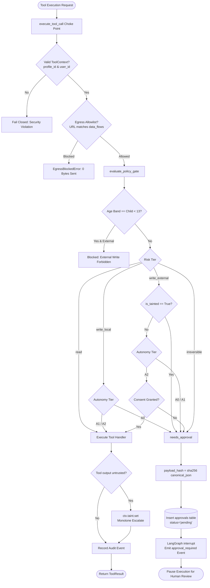
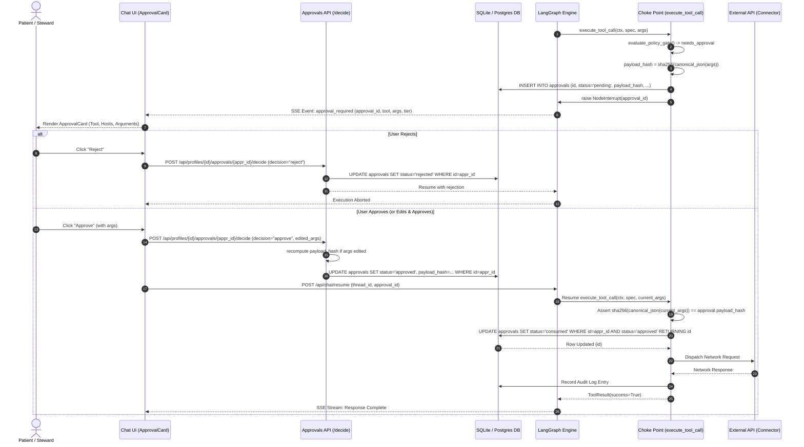
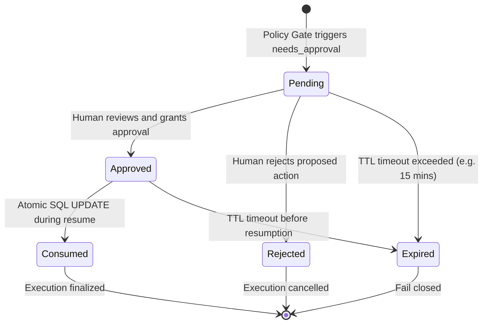

# ADR-0004: Policy Gate, Monotone Taint Propagation, and Atomic Single-Use Approvals Resume

<!--
  Carefold — Healthcare AI Agent Marketplace & Runtime
  Copyright 2026 Spectrayan

  Licensed under the Apache License, Version 2.0 (the "License");
  you may not use this file except in compliance with the License.
  You may obtain a copy of the License at

      http://www.apache.org/licenses/LICENSE-2.0

  Unless required by applicable law or agreed to in writing, software
  distributed under the License is distributed on an "AS IS" BASIS,
  WITHOUT WARRANTIES OR CONDITIONS OF ANY KIND, either express or implied.
  See the License for the specific language governing permissions and
  limitations under the License.
-->

## Metadata

| Property | Value |
|---|---|
| **Status** | `Accepted (Implemented)` |
| **Date** | 2026-10-12 |
| **Authors** | Spectrayan Architecture Working Group (AWG) (`architecture@spectrayan.com`) |
| **Deciders** | Carefold Core Maintainers, Architecture Working Group, Clinical AI Reviewers |
| **Consulted** | Technical Lead & TSC Chair, Security Engineering Reviewers |
| **Informed** | Carefold Open-Source Community |
| **Related** | ADR-0001 (Orchestrator Lifecycle), ADR-0003 (Deep Agents Middleware), ADR-0005 (Vault Threat Model) |

---

## Context & Problem Statement

Carefold autonomous healthcare agents operate across a wide spectrum of tools—from harmless local document lookups and note-taking to high-risk mutations, such as scheduling clinical appointments, syncing calendars, revoking credentials, or exchanging data with external Electronic Health Record (EHR) portals and pharmacy formularies.

In an unconstrained agentic execution environment, tools present four critical failure modes:

1. **Catastrophic Irreversible Execution**: An autonomous model could book an unwanted procedure, delete a patient profile, or mutate clinical records without human verification.
2. **Indirect Prompt Injection & Data Exfiltration**: When an agent processes untrusted inputs (e.g., patient-uploaded medical bills, third-party PDF records, web search snippets, or external FHIR payloads), adversarial instructions embedded in those documents can hijack model reasoning to invoke external egress tools, silently exfiltrating Protected Health Information (PHI).
3. **Replay Attacks and TOCTOU (Time-of-Check to Time-of-Use)**: If approval records can be consumed more than once, or if the parameters executed upon resumption do not match what the human reviewed, an attacker or race condition can replay or tamper with approved operations.
4. **Unfenced Network Egress**: Tools executing arbitrary outbound HTTP requests create unauthorized communication channels, violating healthcare network boundaries and compliance mandates.

Carefold requires a deterministic, centralized policy enforcement architecture that guarantees human authorization where required, locks payload integrity cryptographically, enforces monotone taint escalation, and ensures atomic single-use resumption.

---

## Decision Drivers

- **Universal Execution Choke Point**: Zero un-choked tool calls; every tool invocation must traverse `execute_tool_call`.
- **Deterministic Multi-Dimensional Policy Gate**: Evaluation must be based on explicit runtime dimensions: $\text{risk tier} \times \text{profile autonomy} \times \text{taint status} \times \text{consents} \times \text{age band}$.
- **Monotone Taint Escalation**: Once an untrusted artifact enters the execution context, the taint flag must remain permanently asserted (`True`) for the remainder of the run. Tainted runs must never execute external or irreversible tools without human approval.
- **Cryptographic Payload Binding & Single-Use Tokens**: Approvals must be bound to a canonical SHA-256 hash of their arguments (`payload_hash = sha256(canonical_json(args))`). The approval record must transition atomically from `approved` to `consumed`, preventing replay and race conditions.
- **Strict Egress Firewall**: Outbound network destinations must match declared tool allowlists (`spec.data_flows.allowed_hosts`) or raise `EgressBlockedError` prior to transmitting any network packets.
- **Human-in-the-Loop (HITL) Interruption**: Seamless pause and resume using LangGraph interrupts and typed REST endpoints.

---

## Considered Options

### Option 1: Decentralized Tool-Level Authorizations
* **Description**: Each tool handler implements its own authorization checks, confirmation prompts, and egress filters.
* **Pros**: Simple to prototype initially for isolated tools.
* **Cons**:
  - Fragile and error-prone; any developer authoring a new tool could omit checks, creating severe vulnerabilities.
  - No central audit logging or consistent UI approval interaction.
  - Cannot maintain global runtime state such as cross-tool monotone taint.

### Option 2: Pre-Execution LLM Self-Reflection Prompt
* **Description**: Prompt the LLM before each tool execution to ask whether the action is safe or requires user confirmation.
* **Pros**: Does not require rigid rule definitions.
* **Cons**:
  - Non-deterministic; susceptible to prompt injection, jailbreaking, and hallucination.
  - Completely unacceptable for clinical safety and compliance boundaries.
  - Adds token overhead and latency to every tool call.

### Option 3: Centralized Choke Point with Deterministic Policy Gate, Canonical Payload Hashing, Monotone Taint, and Atomic Single-Use Resume (Selected)
* **Description**: Enforce all tool execution through a central runtime choke point (`execute_tool_call`). Evaluate an immutable policy matrix before execution. If approval is required, pause execution via LangGraph interrupt and persist a pending approval record. Upon user approval, verify argument hashes against the recorded payload hash and atomically consume the token in a single SQL operation.
* **Pros**:
  - 100% fail-closed security: missing context or unlisted hosts abort execution immediately.
  - Deterministic policy enforcement immune to LLM hallucination.
  - Canonical hashing prevents argument tampering (TOCTOU).
  - Atomic database transition prevents replay and double-execution attacks.
  - Monotone taint prevents indirect prompt injection exfiltration.
* **Cons**:
  - Requires maintaining database models and migrations for pending approvals.
  - Requires asynchronous interrupt handling in the orchestrator workflow.

---

## Decision Outcome

**Chosen Option**: **Option 3: Centralized Choke Point with Deterministic Policy Gate, Canonical Payload Hashing, Monotone Taint, and Atomic Single-Use Resume**

### Detailed Technical Specification

#### 1. ToolSpec Registry & 4 Risk Tiers
Every tool available in Carefold is declared as an immutable `ToolSpec` belonging to one of four mutually exclusive risk tiers:

| Risk Tier | Definition | Examples | Default Policy |
|---|---|---|---|
| **`read`** | Purely observational, read-only queries with zero side effects. | `attach-read`, `skill-docs`, `list_agents`, `search_records` | Allowed across all autonomy levels |
| **`write_local`** | State mutations contained strictly within the patient's local profile sandbox. | `workspace-note`, logging blood glucose vitals, saving prep notes | Allowed in A1 and A2; requires approval in A0 |
| **`write_external`** | Outbound network mutations communicating with third-party APIs or connectors. | Calendar event sync, email draft creation, EHR sync | Requires approval in A0 and A1; allowed in A2 if consented; **Always requires approval if tainted** |
| **`irreversible`** | Permanent clinical, financial, or legal actions that cannot be undone. | Booking clinical appointments, deleting patient profiles, revoking credentials | **Always requires human approval** across all autonomy levels |

#### 2. Policy Decision Matrix
The policy gate evaluates the tuple `(risk_tier, autonomy, taint, consent, age_band)`:

```
┌─────────────────┬──────────┬────────┬──────────────┬──────────────────┬─────────────────┐
│ Risk Tier       │ Autonomy │ Taint  │ Consent      │ Age Band         │ Decision        │
├─────────────────┼──────────┼────────┼──────────────┼──────────────────┼─────────────────┤
│ read            │ Any      │ Any    │ N/A          │ Any              │ ALLOW           │
│ write_local     │ A0       │ Any    │ N/A          │ Any              │ NEEDS_APPROVAL  │
│ write_local     │ A1 / A2  │ False  │ Granted      │ Adult / Teen     │ ALLOW           │
│ write_local     │ A1 / A2  │ Any    │ Not Granted  │ Child (<13)      │ NEEDS_APPROVAL  │
│ write_external  │ A0 / A1  │ Any    │ Any          │ Any              │ NEEDS_APPROVAL  │
│ write_external  │ A2       │ False  │ Granted      │ Adult / Teen     │ ALLOW           │
│ write_external  │ A2       │ True   │ Any          │ Any              │ NEEDS_APPROVAL  │
│ write_external  │ Any      │ Any    │ Any          │ Child (<13)      │ BLOCKED         │
│ irreversible    │ Any      │ Any    │ Any          │ Any              │ NEEDS_APPROVAL  │
└─────────────────┴──────────┴────────┴──────────────┴──────────────────┴─────────────────┘
```

*Policy Invariant*: If `taint == True` and `risk_tier in ("write_external", "irreversible")`, the gate **always forces approval**, overriding A2 autonomy.

#### 3. Monotone Taint Escalation
- `TaintFlag` is an object instantiated per tool execution run:
  ```python
  class TaintFlag:
      def __init__(self, initial: bool = False) -> None:
          self._tainted: bool = bool(initial)

      @property
      def is_tainted(self) -> bool:
          return self._tainted

      def set(self) -> None:
          self._tainted = True
  ```
- Any tool labeled `trust="untrusted"` (such as web search queries, external EHR downloads, or untrusted file parsers) wraps its output in `UntrustedResult`.
- When an `UntrustedResult` is produced, `ctx.taint.set()` is invoked.
- Once set, `taint` cannot be cleared for the lifetime of that thread context.

#### 4. Canonical JSON Payload Hashing
To prevent argument tampering between the moment an approval is requested and the moment it is executed, arguments are canonicalized and hashed:

```python
def canonical_json(data: Any) -> str:
    """Produces RFC-8785 compliant canonical JSON string."""
    return json.dumps(data, sort_keys=True, separators=(',', ':'), default=str)

def compute_payload_hash(args: dict) -> str:
    """Computes SHA-256 hex digest of canonical arguments."""
    return hashlib.sha256(canonical_json(args).encode("utf-8")).hexdigest()
```

When an approval is generated, `payload_hash` is calculated and stored in the database `approvals` table.

#### 5. Atomic Resume & Single-Use Token Consumption
The approval lifecycle transitions through four distinct states: `pending` $\rightarrow$ `approved` / `rejected` $\rightarrow$ `consumed` / `expired`.

When the workflow resumes:
1. The engine checks that the approval record exists and has `status == "approved"`.
2. It verifies that `compute_payload_hash(current_args) == approval.payload_hash`. If the user edited the arguments during review, the approval endpoint recomputes `payload_hash` before marking the record `approved`.
3. The engine consumes the token in a single atomic SQL statement:
   ```sql
   UPDATE approvals
   SET status = 'consumed', decided_at = :now
   WHERE id = :id AND status = 'approved'
   RETURNING id;
   ```
4. If the query returns 0 rows (e.g. the token was already consumed by a concurrent request, or expired), execution **fails closed** immediately, raising `ApprovalError("Approval token has already been consumed or is invalid")`.

#### 6. Strict Egress Allowlisting
Before any network connection is opened:
- Target URLs in `args` (`url`, `endpoint`, `target_url`, `host`) are parsed.
- The extracted hostname is matched against `spec.data_flows.allowed_hosts`.
- If the host is not explicitly listed, or if a `write_external` tool defines no allowed data flows, execution fails closed with `EgressBlockedError`, logging an audit security event and transmitting zero network bytes.

---

## Architectural Diagrams

### 1. Policy Gate Decision Flowchart



### 2. Sequence Diagram: Human-In-The-Loop Approval & Resumption



### 3. State Diagram: Approval Token Lifecycle



---

## Consequences

### Positive Consequences
- **Elimination of Uncontrolled Actions**: Irreversible clinical and administrative mutations can never be invoked autonomously without human consent.
- **Indirect Prompt Injection Containment**: Monotone taint propagation ensures that injected instructions in documents cannot trick the agent into unapproved egress.
- **Zero Replay & Zero TOCTOU**: Cryptographic payload hashing guarantees that only verbatim approved arguments are executed, and atomic SQL consumption prevents token reuse.
- **Strict Network Isolation**: `EgressBlockedError` prevents data exfiltration to unauthorized hosts.
- **HIPAA and Child Safety**: Child profiles under 13 cannot execute external writes under any circumstances.

### Negative Consequences
- **Asynchronous Latency**: Workflows requiring approval must pause and await human intervention, increasing end-to-end completion time.
- **Database Overhead**: Requires stateful persistence of pending approvals in `approvals` table.
- **Client Complexity**: Web UI must render interactive approval cards and support resume payloads.

### Neutral / Preserved Behaviors
- Read-only tools and local note-taking under A1/A2 execute synchronously with sub-millisecond overhead.
- Sandboxed tool protocols remain backward compatible.

---

## Verification & Code References

- **Choke Point & Execution Engine**: `backend/src/carefold/engine/tool_exec.py` (`execute_tool_call`, `evaluate_policy_gate`, `canonical_json`, `compute_payload_hash`)
- **Tool Registry & Declarations**: `backend/src/carefold/engine/tool_registry.py` (`ToolSpec`, `RiskTier`, `TrustLevel`)
- **Approvals API Router**: `backend/src/carefold/api/approvals.py` (`list_pending_approvals`, `decide_approval`)
- **Database Model**: `backend/src/carefold/db/models.py` (`Approval`)
- **Alembic Migration**: `backend/src/carefold/db/migrations/versions/0003_autonomy_batch_1.py`
- **Unit & Truth Table Tests**: `backend/tests/test_policy_gate.py`
- **Verification Commands**:
  ```bash
  backend/.venv/bin/pytest backend/tests/test_policy_gate.py
  backend/.venv/bin/pytest backend/tests/test_approvals_api.py
  ```
