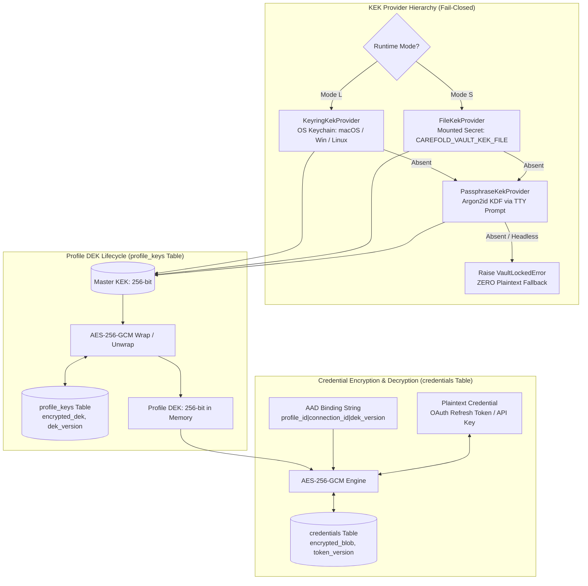
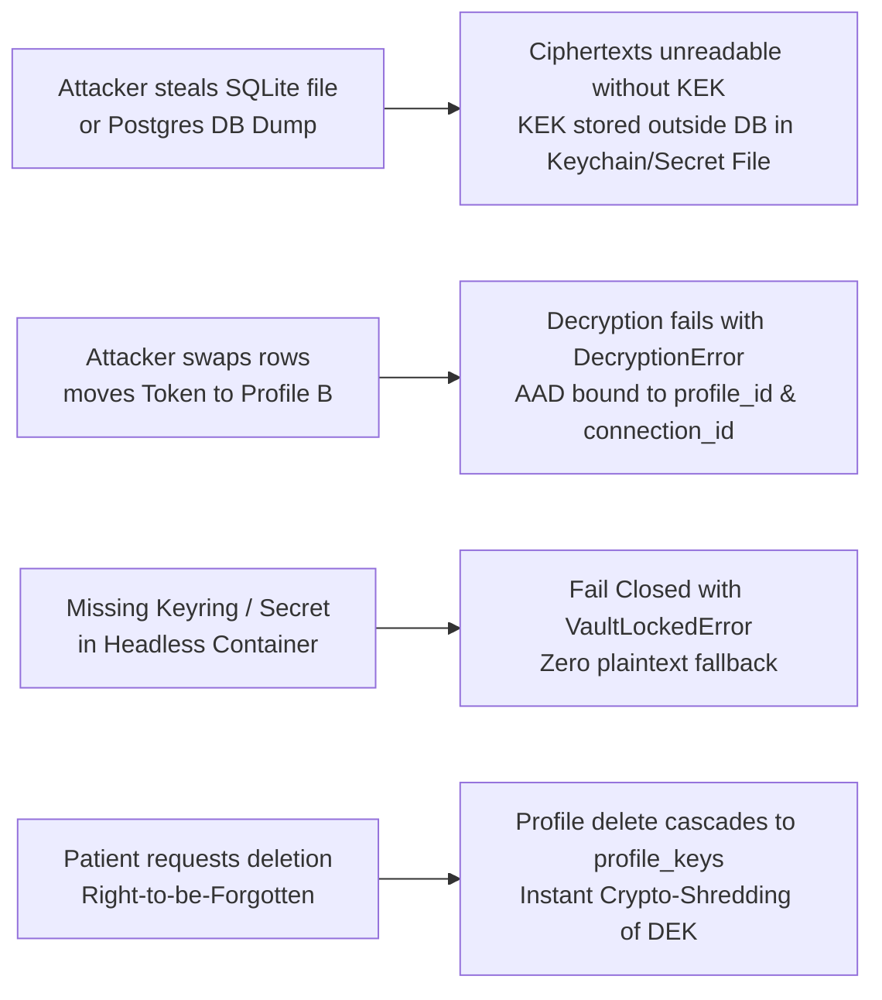
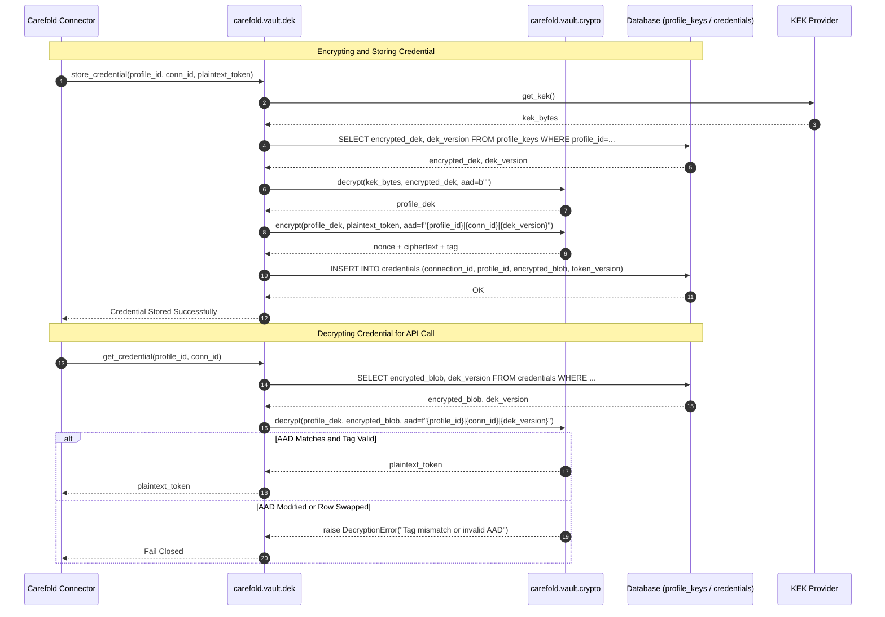
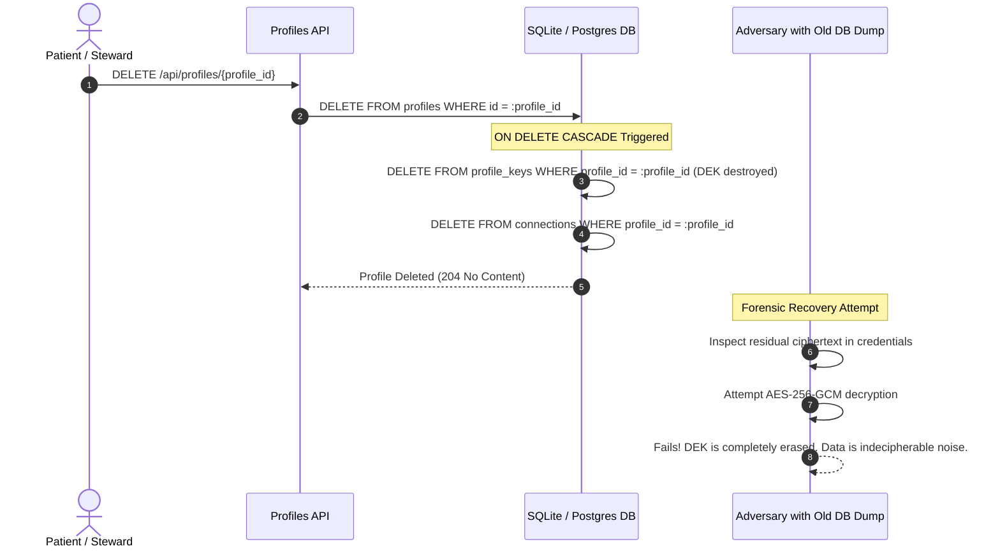

# ADR-0005: Cryptographic Keyring Vault Threat Model, Key Hierarchy, and KEK Resolution Sources

<!--
  Carefold — Healthcare AI Agent Marketplace & Runtime
  Copyright 2026 Spectrayan

  Licensed under the Apache License, Version 2.0 (the "License");
  you may not use this file except in compliance with the License.
  You may obtain a copy of the License at

      http://www.apache.org/licenses/LICENSE-2.0

  Unless required by applicable law or agreed to in writing, software
  distributed under the License is distributed on an "AS IS" BASIS,
  WITHOUT WARRANTIES OR CONDITIONS OF ANY KIND, either express or implied.
  See the License for the specific language governing permissions and
  limitations under the License.
-->

## Metadata

| Property | Value |
|---|---|
| **Status** | `Accepted (Implemented)` |
| **Date** | 2026-10-12 |
| **Authors** | Spectrayan Architecture Working Group (AWG) (`architecture@spectrayan.com`) |
| **Deciders** | Carefold Core Maintainers, Architecture Working Group, Security Engineering Reviewers |
| **Consulted** | Technical Lead & TSC Chair, Clinical AI Reviewers |
| **Informed** | Carefold Open-Source Community |
| **Related** | ADR-0001 (Orchestrator Lifecycle), ADR-0002 (Hexagonal Memory Ports), ADR-0004 (Policy Approvals), ADR-0006 (Deployment Modes) |

---

## Context & Problem Statement

Carefold autonomous agents integrate with external healthcare infrastructure—including Electronic Health Record (EHR) patient portals (Epic MyChart, Cerner FHIR), health insurance clearinghouses, pharmacy benefit networks, Google/Apple calendars, and local wearable devices.

To maintain active sync sessions and execute authenticated queries on behalf of patients, Carefold connectors store sensitive credentials:
- OAuth2 refresh tokens and client secrets
- Third-party API bearer tokens
- Basic authentication credentials and device certificates

### Threat Model & Attack Vectors

1. **Storage Exfiltration (Database Leak)**: If the SQLite database file on an end-user laptop or a PostgreSQL backup on a clinic server is copied, stolen, or accidentally exposed, plaintext credentials would grant an attacker persistent, unauthorized access to the patient's external medical records.
2. **Silent Plaintext Degradation**: Many credential libraries silently fall back to plaintext storage or hardcoded fallback keys when an OS keyring daemon or environment variable is missing. In healthcare applications, a silent fallback violates data protection laws (HIPAA Security Rule 45 CFR § 164.312(a)(2)(iv) and GDPR Art. 32).
3. **Ciphertext Relocation / Row Swap Attacks**: In symmetric encryption without contextual cryptographic binding, an attacker with write access to the database could copy an encrypted credential blob from `Profile A` (a patient) to `Profile B` (an attacker-controlled profile), or swap `connection_id`s, tricking the runtime into decrypting tokens in an unauthorized context.
4. **Multi-Environment Deployment Disparity**:
   - **Mode L (Local Desktop/Laptop)**: Runs directly on developer or patient hardware (macOS, Linux, Windows) where interactive desktop keychains (macOS Keychain, Windows Credential Manager, SecretService) are available.
   - **Mode S (Headless Server / Container)**: Runs in Docker or Kubernetes without a display server or desktop DBus daemon, where credentials must be provisioned via container secret mounts.
   - **Air-Gapped / Headless Fallback**: Systems without OS keychains or pre-mounted secrets require interactive passphrase derivation.
5. **Right-to-be-Forgotten & Data Destruction (Crypto-Shredding)**: When a patient deletes their profile, compliance mandates that all associated credentials be rendered permanently unrecoverable. Rewriting or vacuuming an entire multi-tenant database is slow and non-deterministic on flash storage.

---

## Decision Drivers

- **Scope of Secrets**: Focus specifically on **reconstructible secrets** (OAuth refresh tokens, API keys, client secrets) necessary for connector operations. (Primary clinical health records, chat histories, and notes are managed under their respective storage layers).
- **Two-Tier Key Hierarchy**: Implement an envelope encryption hierarchy: Key Encryption Key (KEK) wrapping per-profile Data Encryption Keys (DEKs).
- **Zero Silent Fallback (Strict Fail-Closed)**: If a valid KEK source cannot be resolved, the vault must raise `VaultLockedError` and fail closed immediately. **Zero plaintext fallback is permitted under any circumstance.**
- **Cryptographic AAD Binding**: AES-256-GCM ciphertexts must be cryptographically bound to row metadata via Authenticated Additional Data: `f"{profile_id}|{connection_id}|{dek_version}"`.
- **Environment-Adaptive KEK Resolution**:
  1. Mode L: OS credential store (`keyring`).
  2. Mode S: Secure mounted secret file (`CAREFOLD_VAULT_KEK_FILE`).
  3. Interactive Fallback: Argon2id passphrase derivation.
- **Instant Per-Profile Crypto-Shredding**: Deleting a profile drops its DEK via database foreign key `CASCADE`, instantaneously rendering all associated credentials permanently undecipherable.

---

## Considered Options

### Option 1: Database-Level Full Disk Encryption (SQLCipher Alone)
* **Description**: Encrypt the entire SQLite database file using SQLCipher with a single global database passphrase.
* **Pros**: Transparent to application models.
* **Cons**:
  - Uses a single shared key for all profiles; cannot provide per-profile crypto-shredding on multi-profile systems.
  - Does not cryptographically bind individual credential rows to specific profiles or connections (no AAD binding).
  - Requires compiling native C extensions, complicating cross-platform packaging.
  - Does not support PostgreSQL deployments in Mode S.

### Option 2: Single Global Static Key via Environment Variable (`SECRET_KEY`)
* **Description**: Provide a single symmetric key in `.env` and encrypt credentials directly.
* **Pros**: Simple to configure.
* **Cons**:
  - Extremely vulnerable to `.env` leakage, process inspection (`/proc/$PID/environ`), and container dump inspection.
  - Single point of failure; compromising the key exposes all patients.
  - Profile deletion does not shred keys; old database backups remain decryptable indefinitely.

### Option 3: Two-Tier Envelope Encryption Hierarchy with Adaptive KEK Resolution, AES-256-GCM + AAD, and Per-Profile Crypto-Shredding (Selected)
* **Description**: Generate a unique 256-bit DEK per profile. Encrypt each DEK under a master KEK and store the ciphertext in `profile_keys`. Encrypt connection credentials under the profile DEK using AES-256-GCM with AAD bound to `profile_id|connection_id|dek_version`. Resolve the KEK via OS Keychain (Mode L), mounted secret file (Mode S), or Argon2id passphrase prompt. Fail closed on missing KEK.
* **Pros**:
  - Fulfills the zero-plaintext invariant: fails closed with `VaultLockedError`.
  - Cryptographic AAD binding prevents ciphertext relocation across rows or profiles.
  - Deleting a profile drops its DEK, providing instantaneous crypto-shredding.
  - Seamless operation across Mode L (desktop) and Mode S (server/Kubernetes).
* **Cons**:
  - Requires managing two keys (KEK and DEK).
  - Headless server environments without pre-mounted secret files require passphrase initialization.

---

## Decision Outcome

**Chosen Option**: **Option 3: Two-Tier Envelope Encryption Hierarchy with Adaptive KEK Resolution, AES-256-GCM + AAD, and Per-Profile Crypto-Shredding**

### Detailed Technical Specification

#### 1. Scope of Secrets: Reconstructible Secrets
The Vault protects **reconstructible secrets**: credentials that can be re-obtained if lost (e.g. by re-authenticating with Epic MyChart, re-generating an API key, or signing in again via OAuth). Primary clinical health data, audit event logs, and patient notes reside in their respective structured tables and content-addressed storage; the Vault is dedicated to securing authentication and authorization material.

#### 2. Envelope Encryption Hierarchy (KEK $\rightarrow$ DEK $\rightarrow$ Data)

```
┌────────────────────────────────────────────────────────┐
│ KEK (Key Encryption Key - 256-bit)                     │
│ Sourced from: OS Keychain / Secret File / Argon2id KDF │
└───────────────────────────┬────────────────────────────┘
                            │ (Wraps / Unwraps via AES-256-GCM)
                            ▼
┌────────────────────────────────────────────────────────┐
│ Profile DEK (Data Encryption Key - 256-bit)           │
│ Stored encrypted in `profile_keys` database table      │
└───────────────────────────┬────────────────────────────┘
                            │ (Encrypts / Decrypts via AES-256-GCM + AAD)
                            ▼
┌────────────────────────────────────────────────────────┐
│ Credential Ciphertext (OAuth Refresh Tokens, Secrets)  │
│ Stored in `credentials` table with AAD binding         │
└────────────────────────────────────────────────────────┘
```

#### 3. AES-256-GCM Symmetric Encryption Engine
The encryption engine in `carefold.vault.crypto` uses standard authenticated symmetric encryption (`cryptography.hazmat.primitives.ciphers.aead.AESGCM`):
- **Key Length**: 256 bits (32 bytes).
- **Nonce (IV)**: 96 bits (12 bytes) generated via `os.urandom(12)` per encryption. Nonces are never reused under the same key.
- **Authentication Tag**: 128 bits (16 bytes) appended to ciphertext.
- **Payload Format**: `nonce (12 bytes) || ciphertext (N bytes) || tag (16 bytes)`.

```python
def encrypt(key: bytes, plaintext: bytes, aad: bytes) -> bytes:
    if len(key) != 32:
        raise ValueError("Encryption key must be exactly 32 bytes (256 bits).")
    nonce = os.urandom(12)
    aesgcm = AESGCM(key)
    ct = aesgcm.encrypt(nonce, plaintext, aad)
    return nonce + ct  # ct contains 16-byte tag appended

def decrypt(key: bytes, payload: bytes, aad: bytes) -> bytes:
    if len(key) != 32:
        raise ValueError("Encryption key must be exactly 32 bytes (256 bits).")
    if len(payload) < 28:  # 12-byte nonce + 16-byte tag
        raise DecryptionError("Ciphertext payload is truncated or corrupted.")
    nonce = payload[:12]
    ct = payload[12:]
    aesgcm = AESGCM(key)
    try:
        return aesgcm.decrypt(nonce, ct, aad)
    except Exception as exc:
        raise DecryptionError(f"Decryption failed or AAD mismatch: {exc}") from exc
```

#### 4. Cryptographic Additional Authenticated Data (AAD) Binding
To strictly prevent ciphertext relocation across rows, connections, or profiles, every credential encryption operation binds to the exact contextual tuple:

$$\text{AAD} = \text{"}\{profile\_id\}|\{connection\_id\}|\{dek\_version\}\text{"}$$

If an adversary copies an encrypted blob from one row in the `credentials` table to another, or alters `profile_id` or `connection_id`, AES-GCM verification fails during decryption, raising `DecryptionError`.

#### 5. Adaptive KEK Resolution Hierarchy & Fail-Closed Guard

The KEK provider protocol resolves keys through a strict precedence hierarchy:

```python
class KekProvider(Protocol):
    def get_kek(self) -> bytes:
        ...
```

1. **Mode L: OS Credential Store (`KeyringKekProvider`)**:
   - Queries Python `keyring` (service: `"carefold_vault"`, username: `"kek"`).
   - If present, returns 32-byte binary key (or decodes 64-character hex string).
   - If not present on first run in Mode L, generates 32 cryptographically secure random bytes and stores them in the OS keychain.
2. **Mode S: Mounted Secret File (`FileKekProvider`)**:
   - Reads the file path specified in `CAREFOLD_VAULT_KEK_FILE` (e.g., `/run/secrets/carefold_kek`).
   - File must be readable and contain exactly 32 raw bytes or 64 hex characters.
3. **Interactive Passphrase Derivation (`PassphraseKekProvider`)**:
   - If neither OS keyring nor secret file is configured, prompts for a master passphrase.
   - Derives a 256-bit key using **Argon2id** (memory cost: 64 MiB, time cost: 3 iterations, parallelism: 4 lanes) using a fixed instance salt stored in `data/.vault_salt`.
4. **Fail-Closed Invariant**:
   - If all providers fail (e.g. running headlessly in server mode without `CAREFOLD_VAULT_KEK_FILE` and no TTY for interactive passphrase), the system raises `VaultLockedError`.
   - **No plaintext fallback is ever permitted.**

#### 6. Profile DEK Lifecycle & Crypto-Shredding
- **Creation**: When a profile is created, `get_or_create_dek(db, profile_id, kek)` generates a new 256-bit DEK (`os.urandom(32)`), encrypts it with the KEK, and inserts a row in `profile_keys`:
  - `profile_id`: Foreign key referencing `profiles.id` with `ON DELETE CASCADE`.
  - `dek_version`: Integer starting at `1`.
  - `encrypted_dek`: Binary ciphertext payload.
- **Crypto-Shredding**: When a user or steward requests profile deletion (`DELETE FROM profiles WHERE id = :id`):
  - Database-level `ON DELETE CASCADE` automatically purges the corresponding row in `profile_keys`.
  - The profile DEK is destroyed instantaneously.
  - All existing ciphertexts in `credentials` (and any other profile-encrypted tables) become permanently indecipherable random noise.
  - This satisfies HIPAA and GDPR right-to-be-forgotten requirements in $O(1)$ time without requiring whole-database zeroization.

---

## Architectural Diagrams

### 1. Two-Tier Envelope Encryption Architecture



### 2. Threat Model Matrix & Attack Mitigations



### 3. Credential Encryption and Decryption Flow with AAD Validation



### 4. Crypto-Shredding Sequence Diagram on Profile Deletion



---

## Consequences

### Positive Consequences
- **Robust Data Protection**: Compromise of the database file or disk backup does not compromise credentials because the KEK is stored outside the database.
- **Relocation Immunity**: AAD binding strictly prevents row-copy and profile-swap attacks.
- **Fail-Closed Security**: `VaultLockedError` ensures no silent plaintext leaks can occur during operational misconfigurations.
- **Instant Compliance**: Crypto-shredding guarantees immediate and mathematically irreversible deletion of patient credentials upon profile removal.
- **Operational Portability**: Seamless adaptation to desktop (Mode L) and cloud container (Mode S) environments.

### Negative Consequences
- **Headless Server Cold Start**: In Mode S without pre-mounted secret files, human intervention (passphrase prompt) is required on daemon start.
- **Key Rotation Overhead**: Rotating the master KEK requires re-encrypting all profile DEKs in `profile_keys` (though credentials themselves do not need to be re-encrypted). Rotating a profile DEK requires re-encrypting that profile's credentials.

### Neutral / Preserved Behaviors
- Read latency for established in-memory sessions remains minimal (AES-NI accelerated symmetric cryptography).
- Standard relational foreign key constraints manage key destruction automatically.

---

## Verification & Code References

- **Symmetric Cryptography**: `backend/src/carefold/vault/crypto.py` (`encrypt`, `decrypt`, AES-256-GCM)
- **KEK Provider Hierarchy**: `backend/src/carefold/vault/kek.py` (`get_kek`, `KeyringKekProvider`, `FileKekProvider`, `PassphraseKekProvider`)
- **DEK Management**: `backend/src/carefold/vault/dek.py` (`get_or_create_dek`, `rotate_dek`)
- **Exception Definitions**: `backend/src/carefold/vault/errors.py` (`VaultLockedError`, `DecryptionError`)
- **Database Models**: `backend/src/carefold/db/models.py` (`ProfileKey`, `Credential`)
- **Alembic Migration**: `backend/src/carefold/db/migrations/versions/0003_household_profiles_and_audit.py`
- **Unit & Security Tests**: `backend/tests/test_vault.py`
- **Verification Commands**:
  ```bash
  backend/.venv/bin/pytest backend/tests/test_vault.py
  ```
