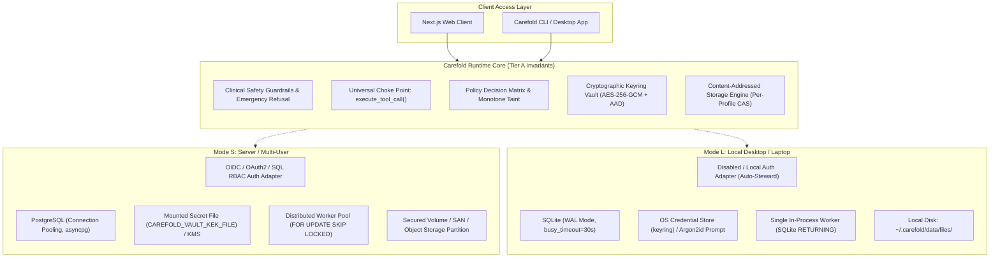
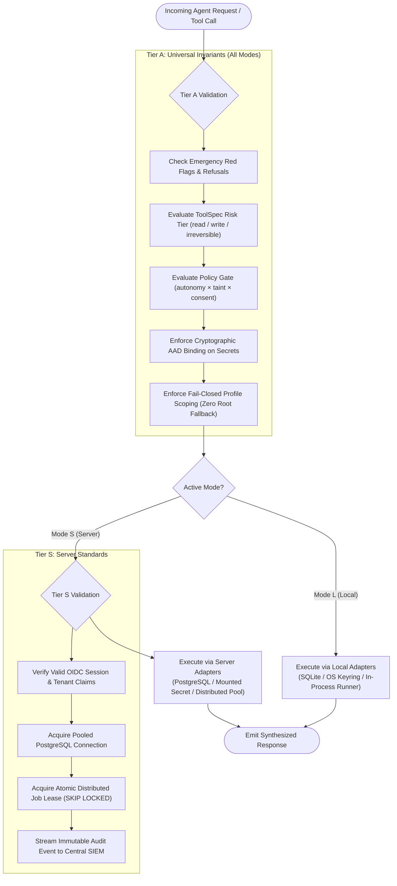

# ADR-0006: Dual Deployment Modes (Mode L & Mode S) and Two-Tier Requirement Standards (Tier A & Tier S)

<!--
  Carefold — Healthcare AI Agent Marketplace & Runtime
  Copyright 2026 Spectrayan

  Licensed under the Apache License, Version 2.0 (the "License");
  you may not use this file except in compliance with the License.
  You may obtain a copy of the License at

      http://www.apache.org/licenses/LICENSE-2.0

  Unless required by applicable law or agreed to in writing, software
  distributed under the License is distributed on an "AS IS" BASIS,
  WITHOUT WARRANTIES OR CONDITIONS OF ANY KIND, either express or implied.
  See the License for the specific language governing permissions and
  limitations under the License.
-->

## Metadata

| Property | Value |
|---|---|
| **Status** | `Accepted (Implemented)` |
| **Date** | 2026-10-12 |
| **Authors** | Architecture Working Group (`architecture@spectrayan.com`) |
| **Deciders** | Carefold Core Maintainers, Clinical AI Reviewers |
| **Consulted** | Technical Lead & TSC Chair, Security Engineering Team |
| **Informed** | Carefold Open-Source Community |
| **Related** | ADR-0004 (Policy Approvals & Resume), ADR-0005 (Vault Threat Model & KEK Sources), ADR-0007 (Content-Addressed Storage & Hybrid Search) |

---

## Context & Problem Statement

Carefold is designed as an open-source, local-first healthcare AI runtime and agent marketplace. In practice, Carefold is deployed across two sharply divergent environments:

1. **Individual Desktop / Laptop (Mode L)**: Personal patients, independent clinicians, or family stewards running Carefold locally on macOS, Linux, or Windows laptops. This environment operates offline-first, utilizes local small language models (via Ollama or local backends), requires zero telemetry, and must run with zero DevOps configuration or external background services.
2. **Institutional Multi-User Server (Mode S)**: Clinic networks, hospital research teams, or managed cloud services running Carefold within Docker / Kubernetes clusters. This environment serves concurrent users, requires robust multi-tenant authentication (OIDC / OAuth2), utilizes managed relational databases (PostgreSQL), and requires strict infrastructure-level secrets management.

Historically, software platforms make one of two critical mistakes:
- **Over-constraining the desktop environment**: Requiring external database daemons (PostgreSQL), centralized identity providers, or cloud KMS services, thereby breaking the local-first promise and preventing adoption by individual patients.
- **Under-constraining the server environment or compromising clinical safety**: Running SQLite single-writer databases with unencrypted storage on multi-tenant servers, or conversely, allowing "desktop mode" to disable essential clinical safety guardrails, emergency red-flag circuits, or cryptographic key separation.

Carefold requires an explicit, standardized architectural framework that formally distinguishes between **deployment operational modes** (Mode L vs Mode S) while establishing immutable, non-negotiable **requirement tiers** (Tier A vs Tier S) to guarantee that clinical safety and cryptographic protection remain inviolable in every deployment.

---

## Decision Drivers

- **Zero-Telemetry Offline Autonomy**: Mode L deployments must function completely self-contained on laptops with zero cloud dependencies, zero external database servers, and zero telemetry exfiltration.
- **Transactional Multi-Tenant Concurrency**: Mode S deployments must support concurrent client connections, distributed background worker pooling, and transactional ACID guarantees without SQLite lock starvation.
- **Universal Clinical Safety Invariants (Tier A)**: Clinical safety boundaries, emergency red-flag detection, human-in-the-loop policy gates, and cryptographic isolation must never be bypassed, degraded, or toggled off in any mode.
- **Operational Scalability & Separation of Concerns (Tier S)**: Production infrastructure requirements (OIDC SSO, PostgreSQL connection pooling, external KMS integration, centralized audit forwarding) must be enforced on servers without imposing operational complexity on local desktop users.
- **Fail-Closed Security Posture**: Missing configuration or cryptographic keys must fail closed across all modes with zero fallback to insecure defaults (such as plaintext storage or permissive permissions).

---

## Considered Options

### Option 1: Monolithic Single-Mode Architecture (Server-Only Stack)
* **Description**: Require PostgreSQL, OIDC identity configuration, and external secret stores across all installations.
* **Pros**: Single deployment configuration and test matrix; zero branching logic in storage and database adapters.
* **Cons**: Totally destroys local-first patient usability; prevents offline operation on airplanes or remote clinics; excessive memory and CPU footprint for single-user laptops.

### Option 2: Split Codebases / Forked Distributions (Desktop vs Server)
* **Description**: Maintain two distinct repositories or binaries: `carefold-desktop` (SQLite, local auth) and `carefold-server` (PostgreSQL, OIDC, cloud).
* **Pros**: Clean physical separation of dependencies.
* **Cons**: Severe architectural divergence; duplicate maintenance overhead; high risk that clinical safety features or policy gates updated in one repo fail to port to the other.

### Option 3: Unified Hexagonal Runtime with Dual Deployment Modes and Two-Tier Requirement Standards (Selected)
* **Description**: Maintain a single codebase governed by hexagonal ports (`MemoryPort`, `CatalogPort`, `StoragePort`, `AuthPort`, `VaultPort`) with two standard deployment modes (**Mode L** and **Mode S**) and two distinct requirement tiers (**Tier A** universal invariants vs **Tier S** server infrastructure standards).
* **Pros**:
  - Enforces identical clinical safety and cryptographic control loops everywhere.
  - Zero-friction single-binary startup for local desktop users.
  - Full enterprise multi-tenancy and high-availability support for server deployments.
  - Pluggable adapters handle environment differences without polluting domain logic.
* **Cons**: Requires database migrations to support dual-dialect compatibility (SQLite `render_as_batch=True` and PostgreSQL native DDL).

---

## Decision Outcome

**Chosen Option**: **Option 3: Unified Hexagonal Runtime with Dual Deployment Modes and Two-Tier Requirement Standards**

### 1. Deployment Modes Specification

Carefold formally defines two operational deployment modes configured via environment variables and configuration settings:

| Architectural Component | Mode L (Local Desktop / Laptop) | Mode S (Server / Multi-User) |
|---|---|---|
| **Primary Target** | Single-user personal desktop, laptop, or offline workstation | Clinic network, hospital department, or multi-user cloud cluster |
| **Relational Database** | SQLite (WAL mode, `busy_timeout=30000ms`) via `aiosqlite` | PostgreSQL 15+ with connection pooling via `asyncpg` |
| **State Checkpointing** | Local SQLite database (`checkpoints.db`) | Managed PostgreSQL database or distributed datastore |
| **Authentication Adapter** | `DisabledAuthAdapter` / `LocalAuthAdapter` with default steward role | `OidcAuthAdapter` or `SqlAuthAdapter` with Argon2id and strict RBAC |
| **Cryptographic KEK Source** | OS Credential Store (`keyring`) with interactive Argon2id prompt fallback | Mounted secret file (`CAREFOLD_VAULT_KEK_FILE`) or cloud KMS; no interactive prompts |
| **Cryptographic DEK Isolation** | Per-profile DEK encrypted under KEK with AAD binding | Per-profile DEK encrypted under KEK with AAD binding |
| **File Storage Subsystem** | Content-Addressed Storage under `~/.carefold/data/files/` | Content-Addressed Storage on secured volume / SAN / Object Storage |
| **Job Runner Execution** | In-process wall-clock polling loop with SQLite `RETURNING` leasing | Distributed multi-worker pool with PostgreSQL `FOR UPDATE SKIP LOCKED` |
| **Network Binding** | `127.0.0.1` (or `0.0.0.0` inside local Docker container) | Reverse-proxy terminated TLS (`443`) with strict CSP and CORS |

---

### 2. Requirement Tiers Specification

Carefold organizes functional and non-functional requirements into two formal tiers:

#### Tier A: Universal Mandatory Invariants (Enforced in ALL Modes)
These requirements are intrinsic to the Carefold healthcare agent runtime and **MUST NEVER** be disabled, downgraded, or bypassed under any configuration:
1. **Clinical Safety Boundaries**: Hard refusal protocols for life-threatening emergencies (`RefusalNode`), non-clinical disclaimer enforcement, and strict prohibition of medical diagnosis or dosage modification.
2. **ToolSpec 4-Tier Risk Classification**: Every tool must be categorized into one of 4 risk tiers (`read`, `write_local`, `write_external`, `irreversible`).
3. **Universal Choke Point Policy Gate**: 100% of tool executions must route through `execute_tool_call` and evaluate the policy gate truth table (`tier × autonomy × taint × consent × age_band`).
4. **Monotone Taint Tracking**: Untrusted input wraps in `UntrustedResult`; once tainted, `ToolContext.taint` remains `True` for the thread duration, forcing human approval on external writes and irreversible actions.
5. **Human-in-the-Loop Approvals & Single-Use Tokens**: Every approval token transitions atomically (`approved -> consumed`); execution validates canonical JSON payload hash `sha256(canonical_json(args))`.
6. **Per-Profile Cryptographic Vault**: Secrets encrypted using AES-256-GCM with mandatory AAD binding (`profile_id|connection_id|dek_version`); profile deletion executes permanent crypto-shredding.
7. **Zero Plaintext Fallback**: Missing KEK or corrupted ciphertexts raise `VaultLockedError`; plaintext fallbacks are strictly prohibited.
8. **Fail-Closed Scoping & Elimination of Root Fallbacks**: Every storage and record access requires explicit `profile_id`; missing or whitespace profile IDs fail closed; zero root fallback.

#### Tier S: Server-Mandatory Standards (Mode S Mandatory, Mode L Recommended)
These requirements are mandatory for multi-user server environments and recommended for advanced local installations:
1. **Federated Identity & OIDC Integration**: Centralized token validation, multi-factor authentication (MFA), and real-time session revocation.
2. **Transactional Concurrency & High Availability**: PostgreSQL backend with automated connection pooling and replication.
3. **Mounted Infrastructure Secrets**: Non-interactive KEK provisioning via Kubernetes secrets or hardware security modules (HSM).
4. **Centralized Immutable Audit Logging**: Real-time structured audit event streaming (`audit.jsonl` forwarding to SIEM / cold storage).
5. **Distributed Job Concurrency**: Distributed worker leasing using `SELECT ... FOR UPDATE SKIP LOCKED` to prevent duplicate execution across horizontal replicas.
6. **Network & Perimeter Hardening**: TLS 1.3 termination, HTTP Strict Transport Security (HSTS), Content Security Policy (CSP), and restrictive CORS policies.

---

### Architectural Diagrams

#### Mode L vs Mode S Component Matrix



#### Requirement Tier Enforcement Lifecycle



---

## Consequences

### Positive Consequences
- **Local-First Integrity**: Patients and clinicians can run the full Carefold stack on a standard laptop with zero cloud accounts, zero telemetry, and complete privacy.
- **Enterprise Scalability**: Healthcare systems can deploy Carefold across container clusters with high availability, transactional guarantees, and federated identity.
- **Uncompromised Safety Posture**: Tier A requirements ensure that local desktop users receive the exact same clinical safety, risk tier gating, cryptographic protection, and approval controls as enterprise users.
- **Developer Simplicity**: Developers can test the entire multi-agent workflow locally using SQLite and OS keychain before deploying to PostgreSQL in staging.

### Negative Consequences
- **Dual Database Migration Maintenance**: Alembic migrations must be maintained with `render_as_batch=True` to support SQLite's table rebuild limitations alongside PostgreSQL DDL.
- **Testing Surface Expansion**: CI matrix must execute regression tests across both SQLite and PostgreSQL backends.

### Neutral / Preserved Behaviors
- **Port Contracts**: Domain services interact strictly with `MemoryPort`, `CatalogPort`, `StoragePort`, and `AuthPort`, remaining 100% agnostic to whether Mode L or Mode S is active.
- **LangGraph State Machine**: Workflow graph nodes, tools, and prompts execute identically across both modes.

---

## Verification & Code References

- **Configuration & Mode Selection**:
  - `backend/src/carefold/config.py`: Deployment mode flags (`is_server_mode`, `home_dir`, `database_url`).
- **Database Engine Resolution**:
  - `backend/src/carefold/db/session.py`: Resolves `aiosqlite` (Mode L) vs `asyncpg` with pooling (Mode S).
  - `backend/src/carefold/db/migrations/env.py`: Enforces `render_as_batch=True` for dual compatibility.
- **Authentication Adapters**:
  - `backend/src/carefold/auth/factory.py`: Resolves `DisabledAuthAdapter` (Mode L) vs `OidcAuthAdapter` / `SqlAuthAdapter` (Mode S).
- **Cryptographic KEK Hierarchy**:
  - `backend/src/carefold/vault/kek.py`: Resolves OS `keyring` (Mode L) -> Mounted secret file (Mode S) -> Argon2id passphrase fallback.
- **Job Runner Leasing**:
  - `backend/src/carefold/engine/job_runner.py`: Implements SQLite `RETURNING` leasing (Mode L) and PostgreSQL `SELECT ... FOR UPDATE SKIP LOCKED` (Mode S).
- **Universal Choke Point & Policy Gate (Tier A)**:
  - `backend/src/carefold/engine/tool_exec.py`: `execute_tool_call` enforcing policy gate, risk tiers, and monotone taint.
- **Verification Commands**:
  ```bash
  # 1. Run full unit and integration suite
  backend/.venv/bin/pytest backend/tests/

  # 2. Run 47-attack security penetration test suite
  PYTHONPATH=backend/src backend/.venv/bin/python backend/tests/penetration_suite.py
  ```
