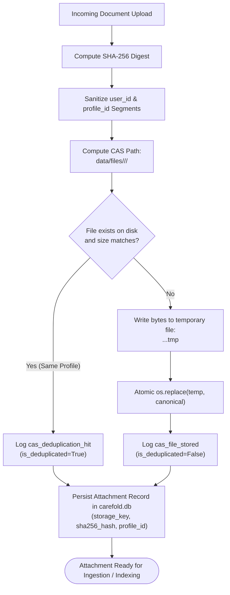
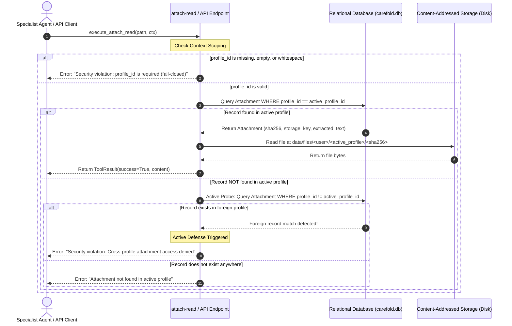
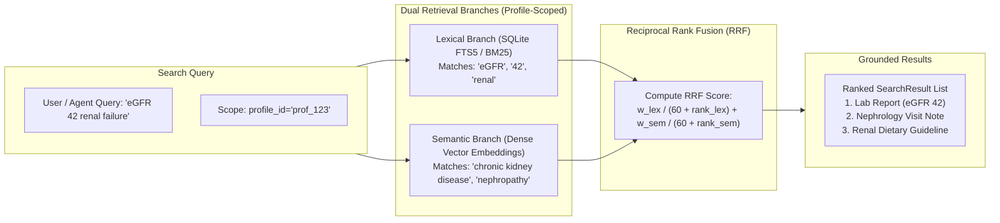

# ADR-0007: Content-Addressed Storage Layout, Fail-Closed Profile Scoping, and Hybrid SearchIndex Architecture

<!--
  Carefold — Healthcare AI Agent Marketplace & Runtime
  Copyright 2026 Spectrayan

  Licensed under the Apache License, Version 2.0 (the "License");
  you may not use this file except in compliance with the License.
  You may obtain a copy of the License at

      http://www.apache.org/licenses/LICENSE-2.0

  Unless required by applicable law or agreed to in writing, software
  distributed under the License is distributed on an "AS IS" BASIS,
  WITHOUT WARRANTIES OR CONDITIONS OF ANY KIND, either express or implied.
  See the License for the specific language governing permissions and
  limitations under the License.
-->

## Metadata

| Property | Value |
|---|---|
| **Status** | `Accepted (Implemented)` |
| **Date** | 2026-10-12 |
| **Authors** | Architecture Working Group (`architecture@spectrayan.com`) |
| **Deciders** | Carefold Core Maintainers, Clinical AI Reviewers |
| **Consulted** | Technical Lead & TSC Chair, Security Engineering Team |
| **Informed** | Carefold Open-Source Community |
| **Upstream Core ADR** | [Yarvelle Core ADR-0009](https://yarvelle.github.io/yarvelle-core/adr/0009-content-addressed-storage-and-hybrid-search/) — [Core ADR-0002 (Dynamic MCP DB Toolbox)](https://yarvelle.github.io/yarvelle-core/adr/0002-dynamic-mcp-db-toolbox/) |
| **Related** | ADR-0002 (Hexagonal Memory Ports), ADR-0005 (Vault Threat Model), ADR-0006 (Deployment Modes & Requirement Tiers) |

---

## Context & Problem Statement

Healthcare AI agents frequently ingest, extract, and ground responses in sensitive clinical files: laboratory blood panels, pathology summaries, cardiology ECG printouts, insurance explanation of benefits (EOB) PDFs, and clinical visit notes.

In earlier iterations of Carefold, document storage and retrieval suffered from three critical security and architectural flaws:

1. **Mutable File Paths & Path Traversal Vulnerabilities**: Files were identified by client-supplied filenames (`blood_test.pdf`). This exposed storage to directory traversal exploits (`../../etc/passwd`, null bytes `\0`, backslash escapes) and allowed accidental or malicious overwriting of historical patient records.
2. **Cross-Tenant Privacy Leaks via Global Deduplication**: Naive Content-Addressed Storage (CAS) systems deduplicate files globally across all users to optimize disk space. In healthcare, global deduplication introduces a catastrophic side-channel vulnerability: an attacker can upload a known diagnostic file (e.g. a rare oncology trial consent form or specific clinic discharge notice) and inspect response timing, deduplication hit flags, or storage usage to determine whether another patient in the system possesses that exact document.
3. **Silent Root Fallbacks & Scoping Failures**: When user or profile context was missing, empty, or unassigned, legacy attachment resolution routines would fall back to an unpartitioned root directory (`attachments/`). This permitted unauthorized cross-profile file access and privilege escalation.
4. **Unimodal Retrieval Blind Spots**: Agent search relied either on naive keyword matching (failing to recognize clinical synonyms such as "myocardial infarction" vs "heart attack") or pure dense vector search (failing to ground precise numerical values, such as "creatinine 2.1 mg/dL", or exact NDC medication codes).

Carefold required an immutable, content-addressed storage layout with strict per-profile partitioning, fail-closed database query semantics, and a robust hexagonal `SearchIndex` protocol providing hybrid (lexical + semantic) retrieval.

---

## Decision Drivers

- **Cryptographic Immutability & Verifiability**: All files must be addressed by their SHA-256 digest, ensuring bitrot detection and tamper-evident storage.
- **Zero Cross-Profile Information Leakage**: Deduplication must be strictly isolated to the profile scope; two distinct profiles uploading identical files must have physically separate files on disk to prevent cross-tenant timing and metadata side channels.
- **Fail-Closed Scoping & Elimination of Root Fallbacks**: Any file operation lacking explicit, valid profile scoping must fail closed immediately with an authorization exception; zero fallback to root directories is permitted.
- **Hybrid Search Grounding (Lexical + Semantic)**: Clinical search must combine exact keyword and numeric precision (SQLite FTS5 / BM25) with semantic vector recall, fused via Reciprocal Rank Fusion (RRF).
- **Atomic File Persistence**: Storage writes must be atomic, preventing corrupt or truncated files during crashes or power loss.

---

## Considered Options

### Option 1: Mutable Filename Storage with Global Deduplication and Permissive Root Fallback
* **Description**: Store files using sanitized original filenames in a shared directory, deduplicate hashes globally across all tenants, and fall back to root `attachments/` if profile ID is missing.
* **Pros**: Simple to implement; maximizes disk space savings.
* **Cons**: Severe security and privacy violations; vulnerable to cross-tenant side-channel attacks on PHI; permits cross-profile read leaks on missing parameters.

### Option 2: Database BLOB Storage with Pure Vector Search
* **Description**: Store raw file bytes directly in PostgreSQL/SQLite `BLOB` columns and index text exclusively into an external vector database.
* **Pros**: Centralized transactional backup; pure similarity search.
* **Cons**: Bloats database backups and transaction logs; poor performance on multi-megabyte PDFs; pure vector search fails on exact clinical codes (NDC, CPT) and numerical thresholds.

### Option 3: Partitioned Content-Addressed Storage (CAS), Fail-Closed DB Resolution, and Hexagonal `SearchIndex` Protocol (Selected)
* **Description**: Structure storage strictly by partition `<carefold_home>/data/files/<user_id>/<profile_id>/<sha256>`, enforce per-profile deduplication, implement fail-closed database resolution with active cross-profile defense, and define a hexagonal `SearchIndex` protocol fusing lexical FTS5 and semantic vector search.
* **Pros**:
  - Physically isolates tenant data, completely eliminating side-channel leakage.
  - Guarantees cryptographic immutability and atomic disk writes.
  - Active cross-profile defense explicitly catches and logs unauthorized access attempts.
  - Hybrid search delivers both exact numerical/code grounding and natural language recall.
* **Cons**: Duplicates identical files uploaded by different profiles across family accounts (an accepted trade-off to ensure HIPAA-grade privacy).

---

## Decision Outcome

**Chosen Option**: **Option 3: Partitioned Content-Addressed Storage (CAS), Fail-Closed DB Resolution, and Hexagonal `SearchIndex` Protocol**

### 1. Content-Addressed Storage (CAS) Layout

All persistent files managed by Carefold are stored in the canonical content-addressed storage layout:

$$\text{Path} = \langle\text{carefold\_home}\rangle/\text{data}/\text{files}/\langle\text{user\_id}\rangle/\langle\text{profile\_id}\rangle/\langle\text{sha256}\rangle$$

#### Path Sanitization & Defense
Partition identifiers (`user_id`, `profile_id`) are sanitized via `sanitize_partition_segment()`:
- Rejects directory traversal sequences (`/`, `\`, `\0`, `..`).
- Strips unsafe characters via regex `[^a-zA-Z0-9._-]`.
- Hexadecimal SHA-256 digests are strictly validated against `^[0-9a-fA-F]{64}$`.

#### Per-Profile Deduplication
Deduplication is strictly scoped per profile:
- When content is uploaded to profile $P_1$, the system checks if the exact file exists at `<carefold_home>/data/files/<user>/<P_1>/<sha256>` with matching byte size. If present, it skips disk rewrite and flags `is_deduplicated=True`.
- If an identical file is subsequently uploaded to profile $P_2$, it is written to `<carefold_home>/data/files/<user>/<P_2>/<sha256>` as an independent physical file.
- **Security Invariant**: No cross-profile or global deduplication is ever performed.

#### Atomic Write Lifecycle
1. Content is written to a hidden temporary file in the destination directory: `.{sha256}.{uuid}.tmp`.
2. Flushed to disk and committed atomically via `os.replace(temp_path, canonical_path)`.
3. If any step fails, temporary files are cleanly removed in a `finally:` block.

---

### 2. Fail-Closed Scoping & Elimination of Root Fallbacks

Every document retrieval operation (in `attach-read`, REST API endpoints, and extraction subgraphs) enforces fail-closed authorization:

1. **Mandatory Profile Identifier**:
   `profile_id` is an absolute prerequisite. Missing, empty, or whitespace profile IDs fail closed immediately:
   ```python
   if not profile_id or not str(profile_id).strip():
       return ToolResult(
           success=False,
           output=None,
           error="Security violation: profile_id is required for fail-closed access.",
       )
   ```
2. **Active Cross-Profile Defense**:
   When resolving an attachment by filename, UUID, or hash:
   - **Step A**: Query `Attachment` where `profile_id == active_profile_id`.
   - **Step B**: If record is not found under the active profile, execute an active probe: check if the identifier matches an attachment under a *foreign* profile (`Attachment.profile_id != active_profile_id`).
   - **Step C**: If a foreign record matches, immediately abort and log an unauthorized access attempt:
     ```python
     return ToolResult(
         success=False,
         output=None,
         error=f"Security violation: Cross-profile attachment access denied for '{raw_path}'.",
     )
     ```
3. **Elimination of Root Fallbacks**:
   The attachment directory is always constructed as `base_dir / uid_str / pid_str`. The system never falls back to an unpartitioned root `attachments/` or `uploads/` directory.

---

### 3. Hexagonal `SearchIndex` Protocol Design

Carefold defines an abstract `SearchIndex` port to decouple document retrieval from underlying database engines:

```python
from abc import ABC, abstractmethod
from typing import Any, Dict, List, Literal, Optional
from pydantic import BaseModel

class SearchResult(BaseModel):
    document_id: str
    chunk_id: Optional[str] = None
    content: str
    score: float
    lexical_score: float = 0.0
    semantic_score: float = 0.0
    metadata: Dict[str, Any] = {}
    profile_id: str

class SearchIndex(ABC):
    """Hexagonal port for profile-scoped hybrid document search."""

    @abstractmethod
    async def index_document(
        self,
        document_id: str,
        text: str,
        metadata: Dict[str, Any],
        profile_id: str,
        user_id: Optional[str] = None,
    ) -> None:
        """Indexes extracted document text into lexical and semantic stores."""
        ...

    @abstractmethod
    async def search(
        self,
        query: str,
        profile_id: str,
        limit: int = 10,
        mode: Literal["hybrid", "lexical", "semantic"] = "hybrid",
        filters: Optional[Dict[str, Any]] = None,
    ) -> List[SearchResult]:
        """Executes profile-scoped search using hybrid reciprocal rank fusion."""
        ...

    @abstractmethod
    async def delete_document(self, document_id: str, profile_id: str) -> bool:
        """Removes a document and all associated chunks/vectors from the index."""
        ...

    @abstractmethod
    async def reindex_all(self, profile_id: str) -> int:
        """Re-generates indices for all documents in the active profile."""
        ...
```

#### Hybrid Reciprocal Rank Fusion (RRF) Formulation
To combine lexical BM25 precision with dense semantic vector recall without score calibration bias, `SearchIndex` computes:

$$RRF(d) = \frac{w_{\text{lex}}}{k + \text{rank}_{\text{lex}}(d)} + \frac{w_{\text{sem}}}{k + \text{rank}_{\text{sem}}(d)}$$

Where:
- $k = 60$ (smoothing constant).
- $w_{\text{lex}} = 0.5$ (lexical weight prioritizing exact lab values, dosages, and codes).
- $w_{\text{sem}} = 0.5$ (semantic weight prioritizing conceptual healthcare meaning).
- Strict Invariant: Results are partitioned and filtered by `profile_id` at the database query level prior to fusion.

---

### Architectural Diagrams

#### CAS Ingestion & Per-Profile Deduplication Pipeline



#### Fail-Closed Retrieval & Cross-Profile Defense



#### Hybrid SearchIndex Fusion Architecture



---

## Consequences

### Positive Consequences
- **Cryptographic Immutability**: All stored files are tamper-evident and protected against bitrot via SHA-256 content addressing.
- **Side-Channel Immunity**: Strict per-profile deduplication prevents cross-tenant presence attacks on sensitive medical conditions.
- **Zero Root Fallback**: Guarantees that unpartitioned directories are never accessed, eliminating privilege escalation.
- **Active Defense**: Proactive foreign-profile queries identify and log malicious cross-tenant file read attempts.
- **High-Precision Retrieval**: Hybrid Reciprocal Rank Fusion ensures clinical agents correctly retrieve both exact lab measurements and conceptual medical diagnoses.

### Negative Consequences
- **Storage Duplication Across Family Profiles**: Identical documents uploaded across multiple profiles in the same household require multiple copies on disk, increasing storage utilization.
- **Index Maintenance Overhead**: Document ingestion requires updating both lexical FTS5 tables and vector embeddings.

### Neutral / Preserved Behaviors
- **Backward-Compatible Schema Aliases**: The `Attachment` model preserves backward-compatible property accessors (`file_name`, `file_size`, `mime_type`) while canonicalizing to `filename`, `size_bytes`, `content_type`, and `storage_key`.

---

## Verification & Code References

- **Content-Addressed Storage Engine**:
  - `backend/src/carefold/storage/cas.py`: Implements `get_cas_path`, `store_cas_file`, `read_cas_file`, and `sanitize_partition_segment`.
- **Hexagonal Storage Port & Local Adapter**:
  - `backend/src/carefold/storage/ports/storage_port.py`: Defines `StoragePort` interface and schemas.
  - `backend/src/carefold/storage/adapters/local_adapter.py`: Implements `LocalStorageAdapter`.
- **Fail-Closed Tool Execution**:
  - `backend/src/carefold/tools/attach_read.py`: Enforces fail-closed scoping, cross-profile defense, and cached text fast-path.
- **REST Endpoints**:
  - `backend/src/carefold/api/attachments.py`: REST upload and download handlers with CAS integration.
- **Database Model**:
  - `backend/src/carefold/db/models.py`: `Attachment` model with `storage_key`, `sha256_hash`, `profile_id`.
- **Search & Memory Adaptation**:
  - `backend/src/carefold/memory/adapters/sqlite/memory_adapter.py`: FTS5 query tokenization and ranking.
- **Verification Commands**:
  ```bash
  # 1. Run systematic CAS stress and partition isolation tests
  backend/.venv/bin/pytest backend/tests/test_cas_empirical_stress.py backend/tests/test_cas_adversarial_refcount.py

  # 2. Run fail-closed scoping and boundary attachment access tests
  backend/.venv/bin/pytest backend/tests/test_m2_adversarial_attachments.py backend/tests/test_chal1_scoped_attachments_adversarial.py
  ```
