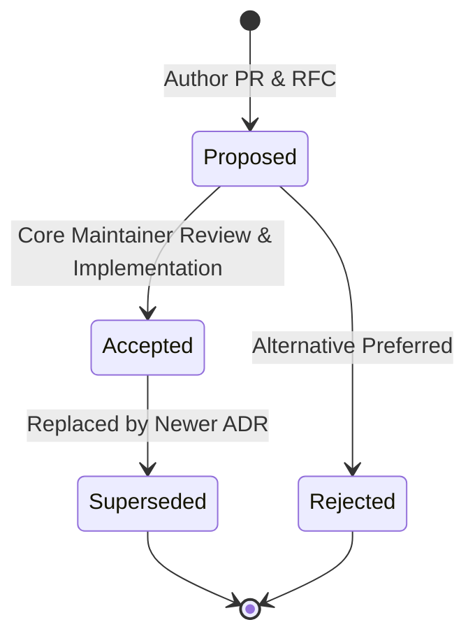

# Architecture Decision Records (ADRs)

Carefold uses **Architecture Decision Records (ADRs)** to document significant architectural, design, and structural decisions made throughout the evolution of the platform.

Because Carefold's domain-neutral agent runtime, deliberation engine, dynamic database toolbox, and 11-layer scope isolation framework live in **[`yarvelle-core`](https://yarvelle.github.io/yarvelle-core/)**, core runtime ADRs are canonically published on the **[Yarvelle Core Documentation Site](https://yarvelle.github.io/yarvelle-core/adr/)** and cross-linked below.

Our ADR system is modeled after the **Spector Living ADR Framework**, ensuring that all architectural choices are transparent, historical, and directly verified against working code.

---

## ADR Lifecycle & Statuses

Every ADR moves through a structured lifecycle:

| Status | Definition |
|---|---|
| **`Proposed`** | The decision is under active review by maintainers and clinical AI reviewers. |
| **`Accepted (Implemented)`** | The decision has been approved, merged, and fully verified against production code. |
| **`Superseded`** | A subsequent ADR has replaced or significantly amended this decision (links to newer ADR). |
| **`Rejected`** | The proposal was evaluated but not adopted. Retained for historical record. |

---

## Immutability & Contribution Rules

1. **Historical Immutability**: Once an ADR is marked `Accepted (Implemented)`, its original problem statement, evaluated options, and trade-off analysis must never be rewritten.
2. **Amending Decisions**: If an architectural requirement changes, do not edit the accepted ADR. Instead, author a new ADR (e.g., `0003-...md`) that explicitly marks the earlier record as `Superseded by ADR-0003`.
3. **Template Compliance**: All new proposals must start from [`0000-template.md`](0000-template.md) and include:
   - Metadata table (Date, Authors, Status, Deciders).
   - Decision Drivers.
   - Considered Options with pros/cons.
   - Decision Outcome.
   - Consequences (Positive, Negative, Neutral).
   - Code verification references.

---

## Yarvelle Core Upstream Runtime ADRs

Core engine decisions governing multi-agent deliberation, dynamic SQL query planning & AST sandboxing, orchestration, hexagonal ports, vault encryption, CAS storage, OAuth relay, and i18n are maintained in [`yarvelle-core`](https://yarvelle.github.io/yarvelle-core/adr/):

| Core ADR # | Title | Status | Date | GitHub Pages Link |
|---|---|---|---|---|
| **[Core-0001](https://yarvelle.github.io/yarvelle-core/adr/0001-multi-agent-deliberation/)** | Multi-Agent Deliberation (`ExecutionMode.DELIBERATE`) | `Accepted (Implemented)` | 2026-10-24 | [`yarvelle.github.io/yarvelle-core/adr/0001-multi-agent-deliberation/`](https://yarvelle.github.io/yarvelle-core/adr/0001-multi-agent-deliberation/) |
| **[Core-0002](https://yarvelle.github.io/yarvelle-core/adr/0002-dynamic-mcp-db-toolbox/)** | Dynamic Multi-Dialect MCP Database Toolbox, M-Schema Catalog, and AST Sandbox | `Accepted (Implemented)` | 2026-10-25 | [`yarvelle.github.io/yarvelle-core/adr/0002-dynamic-mcp-db-toolbox/`](https://yarvelle.github.io/yarvelle-core/adr/0002-dynamic-mcp-db-toolbox/) |
| **[Core-0003](https://yarvelle.github.io/yarvelle-core/adr/0003-orchestrator-driven-agent-architecture/)** | Orchestrator-Driven Multi-Agent Architecture | `Accepted (Implemented)` | 2026-10-02 | [`yarvelle.github.io/yarvelle-core/adr/0003-orchestrator-driven-agent-architecture/`](https://yarvelle.github.io/yarvelle-core/adr/0003-orchestrator-driven-agent-architecture/) |
| **[Core-0004](https://yarvelle.github.io/yarvelle-core/adr/0004-hexagonal-memory-and-catalog-ports/)** | Hexagonal Memory & Catalog Ports Architecture | `Accepted (Implemented)` | 2026-10-02 | [`yarvelle.github.io/yarvelle-core/adr/0004-hexagonal-memory-and-catalog-ports/`](https://yarvelle.github.io/yarvelle-core/adr/0004-hexagonal-memory-and-catalog-ports/) |
| **[Core-0005](https://yarvelle.github.io/yarvelle-core/adr/0005-progressive-disclosure-skill-context-management/)** | Progressive Disclosure & Deep Agents Context Management | `Accepted (Implemented)` | 2026-10-02 | [`yarvelle.github.io/yarvelle-core/adr/0005-progressive-disclosure-skill-context-management/`](https://yarvelle.github.io/yarvelle-core/adr/0005-progressive-disclosure-skill-context-management/) |
| **[Core-0006](https://yarvelle.github.io/yarvelle-core/adr/0006-policy-approvals-and-resume/)** | Policy Approvals, Single-Use Tokens, and Atomic Resumption | `Accepted (Implemented)` | 2026-10-12 | [`yarvelle.github.io/yarvelle-core/adr/0006-policy-approvals-and-resume/`](https://yarvelle.github.io/yarvelle-core/adr/0006-policy-approvals-and-resume/) |
| **[Core-0007](https://yarvelle.github.io/yarvelle-core/adr/0007-vault-threat-model-and-kek-sources/)** | Cryptographic Keyring Vault Threat Model & KEK Hierarchy | `Accepted (Implemented)` | 2026-10-12 | [`yarvelle.github.io/yarvelle-core/adr/0007-vault-threat-model-and-kek-sources/`](https://yarvelle.github.io/yarvelle-core/adr/0007-vault-threat-model-and-kek-sources/) |
| **[Core-0008](https://yarvelle.github.io/yarvelle-core/adr/0008-deployment-modes-and-requirement-tiers/)** | Deployment Modes (Mode L vs Mode S) and Requirement Tiers | `Accepted (Implemented)` | 2026-10-12 | [`yarvelle.github.io/yarvelle-core/adr/0008-deployment-modes-and-requirement-tiers/`](https://yarvelle.github.io/yarvelle-core/adr/0008-deployment-modes-and-requirement-tiers/) |
| **[Core-0009](https://yarvelle.github.io/yarvelle-core/adr/0009-content-addressed-storage-and-hybrid-search/)** | Content-Addressed Storage, Deduplication, and Hybrid Search Protocol | `Accepted (Implemented)` | 2026-10-12 | [`yarvelle.github.io/yarvelle-core/adr/0009-content-addressed-storage-and-hybrid-search/`](https://yarvelle.github.io/yarvelle-core/adr/0009-content-addressed-storage-and-hybrid-search/) |
| **[Core-0010](https://yarvelle.github.io/yarvelle-core/adr/0010-oauth-relay-and-stateless-callback/)** | Stateless OAuth 2.0 PKCE Callback Bounce Relay & Zero-Token Handoff | `Accepted (Implemented)` | 2026-10-14 | [`yarvelle.github.io/yarvelle-core/adr/0010-oauth-relay-and-stateless-callback/`](https://yarvelle.github.io/yarvelle-core/adr/0010-oauth-relay-and-stateless-callback/) |
| **[Core-0011](https://yarvelle.github.io/yarvelle-core/adr/0011-internationalization-and-multilingual-architecture/)** | Multi-Layer Internationalization (i18n), Unicode UAX #15 NFC Storage, and Multilingual Safety Architecture | `Accepted (Implemented)` | 2026-10-14 | [`yarvelle.github.io/yarvelle-core/adr/0011-internationalization-and-multilingual-architecture/`](https://yarvelle.github.io/yarvelle-core/adr/0011-internationalization-and-multilingual-architecture/) |

---

## Carefold ADR Index

| ADR # | Title | Status | Date | Primary Code References | Upstream Core ADR |
|---|---|---|---|---|---|
| **[0000](0000-template.md)** | Architecture Decision Record Template | `Accepted` | 2026-10-02 | — | [Core-0000](https://yarvelle.github.io/yarvelle-core/adr/0000-template/) |
| **[0001](0001-orchestrator-driven-agent-architecture.md)** | Orchestrator-Driven Multi-Agent Architecture | `Accepted (Implemented)` | 2026-10-02 | `carefold/workflows/`, `carefold/loaders/`, `carefold/safety/` | [Core-0003](https://yarvelle.github.io/yarvelle-core/adr/0003-orchestrator-driven-agent-architecture/) |
| **[0002](0002-hexagonal-memory-and-catalog-ports.md)** | Hexagonal Memory & Catalog Ports Architecture | `Accepted (Implemented)` | 2026-10-02 | `carefold/memory/ports/`, `carefold/memory/adapters/sqlite/` | [Core-0004](https://yarvelle.github.io/yarvelle-core/adr/0004-hexagonal-memory-and-catalog-ports/) |
| **[0003](0003-progressive-disclosure-skill-context-management.md)** | Progressive Disclosure & Deep Agents Context Management | `Accepted (Implemented)` | 2026-10-02 | `carefold/engine/`, `skills/*/SKILL.md`, `agents/*/` | [Core-0005](https://yarvelle.github.io/yarvelle-core/adr/0005-progressive-disclosure-skill-context-management/) |
| **[0004](0004-policy-approvals-and-resume.md)** | Policy Approvals, Single-Use Tokens, and Atomic Resumption | `Accepted (Implemented)` | 2026-10-12 | `carefold/engine/tool_exec.py`, `carefold/api/approvals.py`, `carefold/db/models.py` | [Core-0006](https://yarvelle.github.io/yarvelle-core/adr/0006-policy-approvals-and-resume/) |
| **[0005](0005-vault-threat-model-and-kek-sources.md)** | Cryptographic Keyring Vault Threat Model & KEK Hierarchy | `Accepted (Implemented)` | 2026-10-12 | `carefold/vault/crypto.py`, `carefold/vault/kek.py`, `carefold/vault/dek.py` | [Core-0007](https://yarvelle.github.io/yarvelle-core/adr/0007-vault-threat-model-and-kek-sources/) |
| **[0006](0006-deployment-modes-and-requirement-tiers.md)** | Deployment Modes (Mode L vs Mode S) and Requirement Tiers | `Accepted (Implemented)` | 2026-10-12 | `carefold/config.py`, `docker/`, `scripts/` | [Core-0008](https://yarvelle.github.io/yarvelle-core/adr/0008-deployment-modes-and-requirement-tiers/) |
| **[0007](0007-content-addressed-storage-and-hybrid-search.md)** | Content-Addressed Storage, Deduplication, and Hybrid Search Protocol | `Accepted (Implemented)` | 2026-10-12 | `carefold/storage/`, `carefold/memory/`, `carefold/search/` | [Core-0009](https://yarvelle.github.io/yarvelle-core/adr/0009-content-addressed-storage-and-hybrid-search/) |
| **[0008](0008-oauth-relay-and-stateless-callback.md)** | Stateless OAuth 2.0 PKCE Callback Bounce Relay & Zero-Token Handoff | `Accepted (Implemented)` | 2026-10-14 | `carefold/connectors/oauth.py`, `carefold/api/connections.py` | [Core-0010](https://yarvelle.github.io/yarvelle-core/adr/0010-oauth-relay-and-stateless-callback/) |
| **[0009](0009-internationalization-and-multilingual-architecture.md)** | Multi-Layer Internationalization (i18n), Unicode UAX #15 NFC Storage, and Multilingual Clinical Safety Architecture | `Accepted (Implemented)` | 2026-10-14 | `carefold/i18n/`, `frontend/src/i18n/` | [Core-0011](https://yarvelle.github.io/yarvelle-core/adr/0011-internationalization-and-multilingual-architecture/) |
