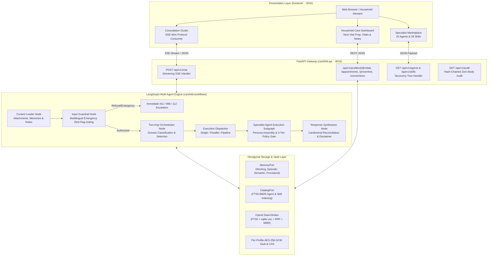

# Architecture Overview

Carefold is engineered as a production-grade healthcare AI agent marketplace and local-first execution runtime built on [`yarvelle-core`](https://yarvelle.github.io/yarvelle-core/) ([GitHub](https://github.com/yarvelle/yarvelle-core)) and `@yarvelle/ui`. It balances clinical empathy and specialty depth with deterministic safety boundaries and household-controlled privacy.

Core runtime capabilities—including [Multi-Agent Blackboard Deliberation (Core ADR-0001)](https://yarvelle.github.io/yarvelle-core/adr/0001-multi-agent-deliberation/) and the [Dynamic Multi-Dialect MCP Database Toolbox & AST Sandbox (Core ADR-0002)](https://yarvelle.github.io/yarvelle-core/adr/0002-dynamic-mcp-db-toolbox/)—are documented in the [Yarvelle Core ADR Catalog](https://yarvelle.github.io/yarvelle-core/adr/).

---

## Monorepo Layout

The repository is structured as a modular monorepo:

```
carefold/
├── backend/                  # FastAPI service & LangGraph multi-agent runtime (carefold + yarvelle-core)
│   ├── src/carefold/         # Core healthcare domain pack & runtime implementation
│   │   ├── api/              # 32 REST & SSE routers (vitals, appointments, preventive, connectors, chat, audit)
│   │   ├── clinical/         # Vitals LOINC normalizer, diurnal BP trends, USPSTF/ACIP preventive rules, school forms
│   │   ├── companion/        # Paired iOS HealthKit & Android Health Connect sync
│   │   ├── connectors/       # OAuth 2.0 PKCE broker, stateless relay, ScopedHttp sandbox & 12 connectors
│   │   ├── engine/           # LangGraph builder, runner, SSE stream & 4-tier ToolExecutionGate
│   │   ├── i18n/             # BCP 47 locale negotiation, UAX #15 NFC, ICU catalogs & multilingual red flags
│   │   ├── importers/        # Apple Health, C-CDA, FHIR R4, CSV & SMART Health Cards (.smart-health-card)
│   │   ├── memory/           # Hexagonal MemoryPort & CatalogPort + SQLite FTS5 / Spector adapters
│   │   ├── search/           # Hybrid SearchIndex (FTS5 + sqlite-vec, RRF, MMR & local reranker)
│   │   ├── storage/          # Per-profile Content-Addressed Storage (CAS)
│   │   ├── vault/            # HKDF-SHA256 per-profile AES-256-GCM envelope encryption keyring vault
│   │   └── workflows/        # 5-phase LangGraph state machine, nodes, and extraction subgraphs
│   └── tests/                # Pytest suite & 47-attack security penetration harness
├── frontend/                 # Next.js 16 Tailwind CSS household care & marketplace UI (@spectrayan/carefold-web)
│   └── src/
│       ├── app/              # App Router pages (/p/[profileId], /agents, /skills, /family, /settings)
│       ├── health-ui/        # @spectrayan/carefold reusable clinical UI components (vitals, visits, preventive)
│       └── i18n/             # Client BCP 47 / ICU MessageFormat & bidirectional LTR/RTL support
├── agents/                   # 25 specialist agent manifests, 6 system agents (_system/), and _template
├── skills/                   # 28 modular clinical and administrative skill packs, plus _template
├── tools/
│   ├── cli/                  # Carefold CLI (@spectrayan/carefold-cli) for authoring, eval & diagnostics
│   └── runner/               # Sandboxed local execution runner (@spectrayan/carefold-runner)
├── deploy/docker/            # Multi-arch Dockerfile and Docker Compose stack
├── docs/                     # Verified MkDocs Material documentation, ADRs (0001–0009) & Compliance Packs
└── .github/                  # GitHub Actions CI/CD, PyPI/NPM/GHCR release workflows & CodeQL security
```

---

## System Component Topology

The diagram below illustrates how requests flow through Carefold's layers:



---

## Key Architectural Principles

### 1. Persona Purity
Agent definitions in Carefold strictly maintain separation of concerns:
- **`persona.md`**: Pure healthcare specialization—clinical focus, communication style, interview protocols, red flags. No filesystem paths, tool call syntax, or document filenames.
- **`agent.yaml`**: Manifest metadata—domain, category, care stages, risk class, declared skills, permitted tools.
- **`SKILL.md` & `references/`**: Modular healthcare protocols, questionnaires, and logging forms.
- **`OrchestratorNode`**: Central intelligence responsible for routing, reference document resolution, dynamic provisioning, and execution topology planning.

### 2. Hexagonal Ports, Hybrid Search & Per-Profile Encryption
All persistence and discovery operations interact with abstract port interfaces (`ADR-0002`, `ADR-0005`, `ADR-0007`):
- `MemoryPort` mediates access to 4 cognitive memory tiers (`WORKING`, `EPISODIC`, `SEMANTIC`, `PROCEDURAL`).
- `CatalogPort` mediates agent and skill indexing and category hierarchy generation.
- Per-profile `HKDF-SHA256` / `AES-256-GCM` Data Encryption Keys isolate household member data at rest across `carefold.db` and Content-Addressed Storage (`CAS`).

### 3. Execution Topologies
The orchestrator plans execution dynamically based on patient presentation complexity:
- **`Single`**: Standard fast-path execution of a single specialist.
- **`Parallel`**: Multimorbid presentations (e.g., overlapping symptoms across cardiology and pulmonology) trigger concurrent execution via `asyncio.gather`.
- **`Pipeline`**: Cross-functional handoffs (e.g., clinical guidance followed by prior authorization navigation) execute in dependency order with topological sorting.

### 4. Zero-Body Hash-Chained Audit Logging & Privacy Safeguards
To safeguard Protected Health Information (PHI):
- Consultation and tool events are recorded in a tamper-evident SHA-256 hash-chained `audit_events` ledger.
- Sensitive prompt and completion bodies are redacted by default (`CAREFOLD_AUDIT_STORE_BODIES=false`).
- Sandboxed file tools enforce strict containment against path traversal, symlink escapes, and unauthorized skill document reads.
